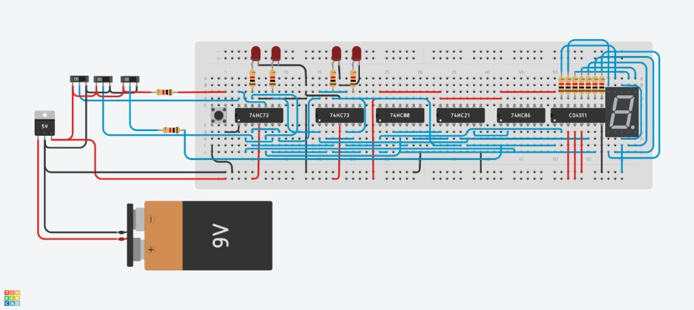
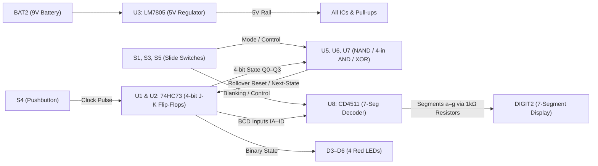

# Discrete-Logic 0–9 BCD Counter

> A 0–9 digital counter built from discrete **74HC73 J-K flip-flops** and basic logic gates—no microcontroller, no pre-built counter IC. Designed and simulated in Tinkercad.



---

## Why This Project?

Most beginner counter tutorials rely on an Arduino or a single-chip counter like a `CD4026` or `74LS90`. Building the counter from **individual flip-flops and logic gates** makes the underlying digital logic visible:

- **Learn sequential logic:** See how four J-K flip-flops form a 4-bit binary register.
- **See binary & decimal side-by-side:** Four red LEDs (`D3–D6`) display the live 4-bit binary value while a `CD4511` decoder drives the 7-segment display (`DIGIT2`).
- **Proper 5V power regulation:** Demonstrates stepping down a 9V battery (`BAT2`) to a regulated 5V rail using an `LM7805` (`U3`).

---

## How It Works



### Stage-by-Stage Breakdown
1. **Power Stage (`BAT2` → `U3`):** A 9V battery feeds the `LM7805` voltage regulator, providing a stable **5V DC** supply for the 74HC-series and CD4511 ICs.
2. **Clock & Controls (`S4`, `S1`, `S3`, `S5`):** Pressing `S4` sends a clock pulse to the flip-flops. The three slide switches control circuit modes/blanking.
3. **4-Bit Counter (`U1`, `U2`):** Two `74HC73` Dual J-K Flip-Flops (4 flip-flops total) hold the 4-bit count (`0000` to `1001`).
4. **Rollover & Control Logic (`U5`, `U6`, `U7`):** Combinational logic (`74HC00` NAND, `74HC21` 4-input AND, `74HC86` XOR) handles the BCD rollover so the counter wraps back to `0` after `9` instead of continuing to `15`.
5. **Dual Display (`D3–D6` & `U8` → `DIGIT2`):**
   - `D3–D6` light up to show the raw 4-bit binary number.
   - `U8` (`CD4511`) decodes the 4-bit BCD value into 7-segment signals (`a–g`) through `1 kΩ` current-limiting resistors.

---

## Controls

| Control | Type | Function |
|---|---|---|
| `S4` | Pushbutton | Manual clock pulse (advances count) |
| `S1` | Slide Switch | `J` input debugging |
| `S3` | Slide Switch | `K` input debugging |
| `S5` | Slide Switch | Manual reset |

---

## Count Sequence (BCD `0–9`)

| Decimal (`DIGIT2`) | Binary (`Q3 Q2 Q1 Q0`) | Notes |
|---|---|---|
| `0` | `0 0 0 0` | Initial / Reset state |
| `1` | `0 0 0 1` | |
| `2` | `0 0 1 0` | |
| `3` | `0 0 1 1` | |
| `4` | `0 1 0 0` | |
| `5` | `0 1 0 1` | |
| `6` | `0 1 1 0` | |
| `7` | `0 1 1 1` | |
| `8` | `1 0 0 0` | |
| `9` | `1 0 0 1` | Max valid BCD digit |
| `10` *(transient)* | `1 0 1 0` | Triggers reset logic → wraps to `0000` |

---

## Bill of Materials (BOM)

| Designator | Qty | Component | Role |
|---|---|---|---|
| `BAT2` | 1 | 9V Battery | Main power source |
| `U3` | 1 | LM7805 (5V Regulator) | Steps 9V down to 5V DC |
| `U1`, `U2` | 2 | 74HC73 (Dual J-K Flip-Flop) | 4-bit counter register |
| `U5` | 1 | 74HC00 (Quad 2-Input NAND) | Combinational / reset logic |
| `U6` | 1 | 74HC21 (Dual 4-Input AND) | State decoding / rollover logic |
| `U7` | 1 | 74HC86 (Quad 2-Input XOR) | Logic gating |
| `U8` | 1 | CD4511 | BCD-to-7-segment decoder/driver |
| `DIGIT2` | 1 | Common Cathode 7-Segment Display | Decimal output (`0–9`) |
| `D3–D6` | 4 | Red LEDs | 4-bit binary indicators |
| `R2, R3, R5–R15` | 13 | 1 kΩ Resistors | Current limiting & pull-down/series |
| `S4` | 1 | Pushbutton | Manual clock input |
| `S1, S3, S5` | 3 | Slide Switches | Mode / control switches |
| `2` | 1 | Breadboard | Prototyping board |

---

## Project Files

```text
bcd-counter-0-to-9/
├── README.md
└── assets/
    ├── breadboard.jpg    # Tinkercad breadboard layout
    ├── schematic.pdf     # 2-sheet Tinkercad schematic (add your PDF here)
    └── bom.csv           # Exported Tinkercad BOM (add your CSV here)
```

---

## Tips for Rebuilding on Real Hardware
- **Switch Debouncing:** Mechanical pushbuttons (`S4`) bounce when pressed, which can cause the counter to jump 2–3 numbers at once. In real hardware, add a small capacitor (e.g., `0.1 µF`) or an RC/Schmitt-trigger debounce circuit on `S4`.
- **Unused Inputs:** Never leave unused CMOS inputs (`74HCxx`) floating—tie them to `GND` or `5V` as appropriate to avoid erratic counting.
- **Decoupling Capacitors:** Add `0.1 µF` ceramic capacitors near the `LM7805` and IC `VCC` pins when building on a physical breadboard.
